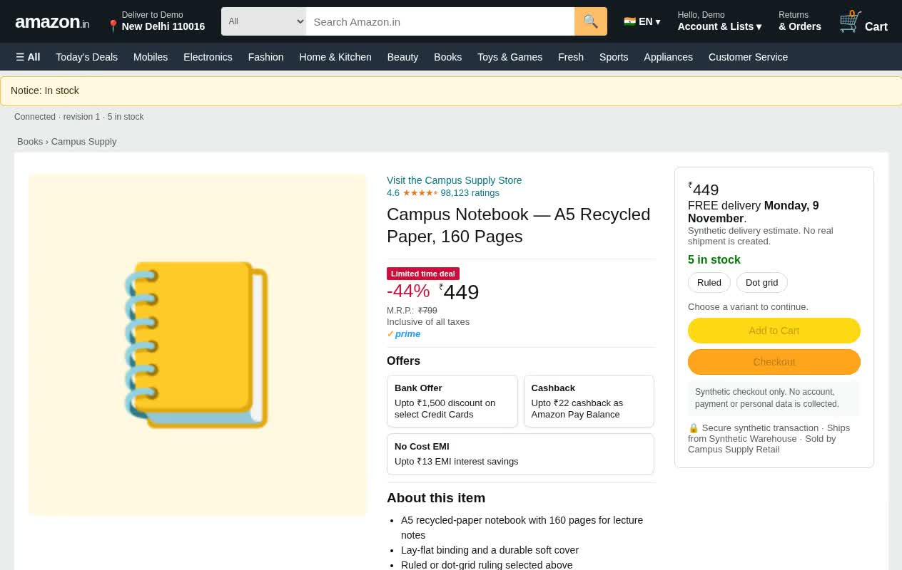

# Sightline

[](https://github.com/NikkeTryHard/hackutd2026)


**UI/UX for the people, by the people.**

Visual agents explore websites through screenshots, mouse movements, and keyboard input. Watch live browser previews, inspect findings, and guide each agent from its own workspace.

## Demo

[](https://github.com/NikkeTryHard/hackutd2026/raw/refs/heads/main/public/media/sightline-browser-demo.mp4)

[Watch the video](https://github.com/NikkeTryHard/hackutd2026/raw/refs/heads/main/public/media/sightline-browser-demo.mp4)

## Run

```sh
bun install
cp .env.example .env
bun run db:start
```

Publish the database module using the [database setup](spacetimedb/README.md), configure your model in `.env`, and run `bun run dev`.

The demo uses controlled shopping and campus websites with intentional defects and clean verification twins. Interaction profiles are synthetic testing conditions, not validated demographic simulations. The recorded demo is not a benchmark result.
